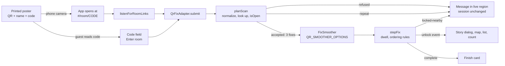

# Design: Haunted House Party

## Overview
Haunted House Party swaps the position source, not the engine. A scanned or typed room code becomes a short burst of fixes at that room's place on an invented floor plan. The fixes go through the same `FixSmoother` and `stepFix` as a GPS walk, so ordering rules (`requires`, `finale`, `ordering`), the session, `TourMap`, `StopList`, the story dialog and the finish state are the skeleton's own. Nothing in `template/src/core` changes, so Ghost Walk and Scavenger Hunt cannot change behavior.

The app has three hash routes: `#/` (party), `#/room/<CODE>` (what a poster's QR opens, handled and replaced with `#/` at once) and `#/posters` (print view).

## Files to add or change
Add:
- `template/src/adapters/qr-fix.ts`: room-code rules, room index, scan planning, `QrFixAdapter`, `listenForRoomLinks`.
- `template/test/qr-fix.test.ts`: unit tests for the code rules, the room index, scan planning and the adapter driven through the real smoother and `stepFix`.
- `apps/haunted-house/` (generated by `npm run create-app -- haunted-house --name "Haunted House Party" --dev-port 3178 --preview-port 3179`, then edited):
  - `package.json`: generated, plus `"qrcode": "1.5.4"` (the exact version in `apps/scavenger-hunt/package.json`). `@types/qrcode` is already a root dev dependency.
  - `vite.config.ts`, `index.html`: generated.
  - `src/main.tsx`: generated, with the fonts and `styles.css` import added.
  - `src/rooms.ts`: the six rooms, their codes and grid positions, the in-character poster lines, and the `house` tour built with `defineTour`.
  - `src/HouseApp.tsx`: route switch, session wiring, scan handling.
  - `src/CodeEntry.tsx`: code field, button, live region.
  - `src/Posters.tsx`, `src/Poster.tsx`: print view and one poster.
  - `src/QrCode.tsx`: SVG QR drawn on the device (same approach as `apps/scavenger-hunt/src/QrCode.tsx`, dark on white, error correction M).
  - `src/Finish.tsx`: finish card.
  - `src/styles.css`: screen styles, reduced motion and the `@media print` rules.
  - `test/rooms.test.ts`: room data rules.
- `e2e/haunted-house.spec.ts`, `e2e/haunted-house.a11y.spec.ts`.
- `.kiro/agents/costume-builder.json` is already written and is not part of the build.

Change:
- `template/src/adapters/index.ts`: `export * from './qr-fix';`.
- `playwright.config.ts`: `HOUSE_PORT` from `PW_HOUSE_PORT` (default 3179), project `haunted-house`, a `webServer` entry that builds and previews `apps/haunted-house`.
- `package.json` (root): add `"apps/haunted-house"` to `workspaces`; add a `dev:house` script; add the app to `build`.

Not changed: everything under `template/src/core`, `template/src/react`, `apps/ghost-walk`, `apps/scavenger-hunt`, `site/`, `README.md`, `KIRO-LOG.md` (the last three are the developer's, see tasks).

## What a scan must emit
The engine and the smoother were written for GPS. A scan is one event, so the adapter has to emit enough, and the right kind of, fixes. Reading `geofence.ts` and `smoothing.ts`:

1. **Dwell.** `stepFix` counts consecutive fixes inside the radius and raises `enter` only when the count reaches `dwellFixes` (default 2). One fix would never unlock anything. The adapter emits `fixesPerScan = 3`, one more than the default, so a change of `dwellFixes` to 3 still works. A fourth fix would add nothing: `enter` fires only when `inside` was false, and `unlock` returns early once `unlockedAt` is set. Three fixes therefore give one `enter` and one `unlock`, however many fixes follow.
2. **Accuracy.** `FixSmoother` drops fixes with accuracy above `maxAccuracy` (60 m) and adopts a missing one as 15 m. The adapter reports 5 m. It is a claim of "within a room", not a measurement, and it keeps the smoothed position tight.
3. **Smoothing.** The default smoother is a Kalman filter that expects walking: `maxSpeed` 9 m/s and `processNoise` 3 m/s. A guest who scans the Parlor and then the Library 80 m of floor plan away, a few seconds later, would be treated as an outlier (a 70 m jump after allowing for accuracy, against 9 m in one second), and a filter that did accept it would blend the new fix only part way (gain about 0.6 after one second), leaving the estimate outside the room's radius. A scan is a teleport, so the app passes `QR_SMOOTHER_OPTIONS = { maxAccuracy: 60, maxSpeed: 1e6, processNoise: 1000 }` to `useTourSession`. With processNoise 1000 the variance grows by 1,000,000 m² per second, the gain is 0.999975, and the estimate lands within a millimetre of the room's position. `maxSpeed` of 1e6 m/s disables the outlier test for scans. The first fix after `smoother.reset()` is adopted as-is in either case. `useTourSession` takes these as an existing option, so no template hook changes.
4. **Time.** The smoother returns `stale` when `dt < 0`, and the trail and `startedAt` use fix timestamps. Fix `i` of a scan has timestamp `t0 + i * 1000`, where `t0 = max(now, lastTimestamp + 1000)`, and `lastTimestamp` is the last emitted timestamp. Timestamps strictly increase even if the clock steps back, and the three fixes are one second apart so the smoother sees `dt = 1 s`. Nothing waits: the fixes are emitted at once and the timestamps are only data. `startedAt` is the first scan's time; `completedAt` is the last unlock's fix time, which can run up to two seconds ahead of the wall clock. That is accurate enough for a party timer.
5. **Position.** The fix is the room's exact grid position, so the distance to that room is 0 and to every other room is more than `1.3 × max(radius)`. `createRoomIndex` checks this (Req 4.5), so the scan enters one room only, the other rooms are marked as exited, and the trail and map marker show the guest "in" that room.
6. **Sunset rooms.** The house tour never sets `wakesAfter`, so the engine's sunset rule does not apply.

**Ordering and a waiting room.** A scan of a room whose `requires` are unfinished makes `stepFix` set `inside = true` and emit `locked-nearby`; the room stays closed. Because the room is `inside`, `settleInside` opens it as soon as its requirements finish, which the guest sees as "it opened when you finished the Library" (Req 4.7). Scanning any other room moves the guest away (`exit`), after which the guest must scan the waiting room again. A scan of an already-open room is answered by the adapter alone (`repeat`) and emits nothing.

## Types and algorithm (`template/src/adapters/qr-fix.ts`)
```ts
import type { LatLng } from '../core/geo';
import type { Fix, SmootherOptions } from '../core/smoothing';
import type { Tour } from '../core/tour';
import type { PositionListener, PositionSource } from './position';

/** Letters except I, L, O, and digits 2 to 9: 31 symbols, 31^4 = 923,521 codes. */
export const ROOM_CODE_ALPHABET = 'ABCDEFGHJKMNPQRSTUVWXYZ23456789';
export const ROOM_CODE_LENGTH = 4;

export type CodeProblem = 'empty' | 'malformed';
export type NormalizedCode =
  | { ok: true; code: string }                       // upper case, no spaces or dashes
  | { ok: false; problem: CodeProblem; message: string };

export function normalizeRoomCode(input: string): NormalizedCode;
/** '#/room/ab-cd' gives 'ab-cd'; null for any other hash. Does not validate. */
export function roomCodeFromHash(hash: string): string | null;
export function roomLink(baseAddress: string, code: string): string; // base without its hash + '#/room/' + code

export interface RoomIndex {
  readonly tour: Tour;
  stopIdForCode(code: string): string | undefined;   // code already normalized
  positionOf(stopId: string): LatLng;
}
/** Throws QrFixError listing every problem: missing, malformed or duplicate codes; rooms too close. */
export function createRoomIndex(tour: Tour, codes: Readonly<Record<string, string>>, exitFactor?: number): RoomIndex;
export class QrFixError extends Error { constructor(readonly issues: string[]); }

export interface ScanOptions {
  fixesPerScan?: number;   // default 3, never below 1
  accuracy?: number;       // default 5 (m)
  spacingMs?: number;      // default 1000
}
export type ScanOutcome =
  | { status: 'accepted'; stopId: string; code: string; fixes: Fix[] }
  | { status: 'repeat'; stopId: string; code: string }                    // already open: no fixes
  | { status: 'refused'; reason: 'empty' | 'malformed' | 'unknown'; message: string };

/** Pure. Decides what one submitted code means and which fixes it produces. */
export function planScan(
  index: RoomIndex,
  input: string,
  ctx: { now: number; lastTimestamp: number; isOpen: (stopId: string) => boolean },
  options?: ScanOptions,
): ScanOutcome;

/** Passed to useTourSession so a scan lands exactly on its room. */
export const QR_SMOOTHER_OPTIONS: SmootherOptions;   // { maxAccuracy: 60, maxSpeed: 1e6, processNoise: 1000 }

export interface QrFixAdapterOptions extends ScanOptions {
  isOpen?: (stopId: string) => boolean;  // default: nothing is open
  now?: () => number;                    // default Date.now
}

/** A PositionSource whose fixes come from room codes instead of satellites. */
export class QrFixAdapter implements PositionSource {
  readonly kind = 'gps' as const;   // the interface only knows 'gps' | 'simulated'; see open question 1
  constructor(index: RoomIndex, options?: QrFixAdapterOptions);
  start(listener: PositionListener): void;   // status('tracking'), then flushes fixes queued before start
  stop(): void;
  /** Plans the scan, emits its fixes to the listener (or queues them until start), returns the outcome. */
  submit(input: string): ScanOutcome;
}

/** The one browser-facing function. Calls onCode for the current hash and for every later hashchange, then replaces the hash with '#/'. Returns an unsubscribe. */
export function listenForRoomLinks(
  target: {
    location: { hash: string };
    history: { replaceState(data: unknown, unused: string, url?: string): void };
    addEventListener(type: 'hashchange', fn: () => void): void;
    removeEventListener(type: 'hashchange', fn: () => void): void;
  },
  onCode: (raw: string) => void,
): () => void;
```

`planScan` steps:
1. `normalizeRoomCode(input)`. Not ok: `refused` with the message (Req 1.4, 1.5).
2. `index.stopIdForCode(code)`. Undefined: `refused`, `reason: 'unknown'`, message `No room has the code ${code}. Check the poster and try again.` (Req 1.6). No fixes.
3. `isOpen(stopId)`: `repeat`, no fixes (Req 4.8).
4. Otherwise `t0 = max(ctx.now, ctx.lastTimestamp + spacingMs)`; `fixes[i] = { ...positionOf(stopId), accuracy, timestamp: t0 + i * spacingMs }` for `i < fixesPerScan` (Req 4.1, 4.2).

`QrFixAdapter.submit` calls `planScan`, and for `accepted` records `lastTimestamp` as the last fix's timestamp and delivers the fixes to the listener. A waiting room still produces an `accepted` outcome, because the engine, not the adapter, owns the ordering rules. The app learns that a room is waiting from the `locked-nearby` event, and names the rooms with `availability(tour, state, stopId).waitingFor` (a message only; the engine still decides).

**App wiring (`HouseApp.tsx`).**
```ts
const index = useMemo(() => createRoomIndex(house, ROOM_CODES), []);
const stateRef = useRef<SessionState>();                      // updated each render from session.state
const adapter = useMemo(() => new QrFixAdapter(index, { isOpen: (id) => isUnlocked(id, stateRef.current!) }), [index]);
const session = useTourSession(house, {
  store, smoother: QR_SMOOTHER_OPTIONS, createGpsSource: () => adapter,
  onEvent: (e) => { if (e.type === 'unlock') dialog.open(e.stopId); /* locked-nearby: announce */ },
});
stateRef.current = session.state;
useEffect(() => { session.startGps(); return session.stop; }, []);   // starts the adapter; no permission prompt
useEffect(() => listenForRoomLinks(window, (raw) => announce(adapter.submit(raw))), [adapter]);
```
The start effect comes before the link effect, so the listener is attached before the first scan. `submit` also queues fixes if it is called earlier. `isUnlocked` is from `core/rules`. The code form calls `adapter.submit` and shows the same outcome messages.

**Floor plan.** Rooms sit on a grid of whole cells, 1 cell = 40 m of pseudo-ground, mapped to latitude and longitude near 0°, 0° (open ocean, no address): `lat = y * 40 / 111195`, `lng = x * 40 / 111195`. The 40 m cell keeps rooms far apart for the 10 m minimum radius (all rooms use radius 12, so the minimum distance must exceed 15.6 m). The map is a stylized drawing, so the unit is not shown to guests.

| Room | Code | Cell (x, y) | Rules |
| --- | --- | --- | --- |
| Front Hall | BATS | (1, 0) | none |
| Parlor | MUMS | (0, 1) | none |
| Library | EERY | (2, 1) | none |
| Kitchen | STEW | (1, 2) | none |
| Attic | WEBS | (2, 3) | `requires: ['library']` |
| Cellar | CRYP | (0, 3) | `finale: true` |

Every room is `kind: 'fiction'`, `ordering: 'free'`, radius 12. Each room has a clue, a story of one or two short paragraphs and a poster line, for example the Library's "Every book here is about you. Please do not read chapter nine." Codes are not secret: they are printed on the posters, and typing is an equal path. The game runs on the honor system.

**Posters.** `Posters.tsx` renders `house.stops.map(room => <Poster …/>)`. Each `Poster` has a QR of `roomLink(address, code)`, the room name, the code in a 64 pt-or-larger element and the line. The address field defaults to `location.origin + location.pathname` and shows the warning for `localhost`, `127.0.0.1`, `[::1]` and `file:` addresses. Print CSS:
```css
@page { margin: 12mm; }
@media print {
  .hh-screen-only { display: none !important; }   /* nav, address field, buttons, privacy note, party view */
  .hh-poster { break-after: page; page-break-after: always; break-inside: avoid; }
  .hh-poster:last-child { break-after: auto; page-break-after: auto; }
  .hh-code { font-size: 72pt; }
}
```
Everything that is not a poster carries `hh-screen-only` and is removed from layout when printing, so no blank page appears. A poster is sized in `mm`-independent units (flex column, centered, no fixed page height), so it fits A4 and US Letter alike; the e2e PDF test checks six pages on both sizes.

## Diagram


## Error handling
| Situation | Behavior |
| --- | --- |
| Empty field | Refused: "Type the four-character code printed on the poster." Focus stays in the field. |
| Wrong length or characters | Refused with the Req 1.5 message. |
| Well-formed code, no such room | Refused with the Req 1.6 message, naming the cleaned code. Session unchanged. |
| Lowercase, spaces or dashes (`ba ts`, `BA-TS`) | Accepted as `BATS`. |
| Room already open | "You have already visited the Library." No fixes, no dialog. |
| Room waiting for another | "The Attic is not open yet. Visit the Library first." The room stays closed and opens when the Library is finished, unless the guest scans another room first. |
| Link opened before the adapter starts | `submit` queues the fixes; `start` flushes them. |
| Hash is not `#/room/...` | Ignored by `roomCodeFromHash`. |
| Damaged saved progress | `ProgressStore` already starts a fresh session. |
| Clock steps backwards | `t0 = max(now, lastTimestamp + 1000)` keeps timestamps increasing; no `stale` fixes. |
| Poster address is localhost or `file:` | Warning on the posters view; printing is still allowed. |
| Tour data wrong (duplicate code, rooms too close) | `createRoomIndex` throws `QrFixError` listing every issue; `rooms.test.ts` fails first, so the app never ships it. |
| App opened in a browser with no `CompressionStream`, camera or location | No effect: the app uses none of them. |

## Correctness properties
1. **Each room unlocks at most once, however often it is scanned.** For any sequence of submitted codes (valid, lowercase, spaced, repeated, interleaved with other rooms), the engine emits at most one `unlock` event per room and `unlockedAt` is never rewritten. Checked by a seeded random sequence test (no new dependency) that runs `planScan` output through `FixSmoother(QR_SMOOTHER_OPTIONS)` and `stepFix`.
2. **A code that is not in the tour never changes the session.** `planScan` returns `refused` with no fixes, and a `deepEqual` of the session before and after holds, including `lastFix`, `trail` and `startedAt`.
3. **A scan unlocks the scanned room if the rules allow, and never any other room.** Starting from any reachable state, an accepted scan of room R leaves every other room's `unlockedAt` as it was. This depends on the spacing check in `createRoomIndex`.
4. **The GPS apps' behavior is unchanged.** No file in `template/src/core`, `template/src/react`, `apps/ghost-walk` or `apps/scavenger-hunt` changes, and their unit and e2e tests pass unedited.
5. **Fix timestamps strictly increase.** Over any sequence of scans and any clock readings, including one that moves backwards, emitted timestamps strictly increase, so the smoother never returns `stale`.
6. **A code survives the poster round trip.** For every room, `normalizeRoomCode(roomCodeFromHash(new URL(roomLink(base, code)).hash))` equals the code.
7. **No data leaves the phone.** During an e2e run, every request after the first load goes to the app's own origin, and none has a query string or body.

## Testing strategy
- **Unit, `template/test/qr-fix.test.ts`:** code rules (alphabet, case, spaces, dashes, each refusal message); `roomCodeFromHash` and `roomLink`; `createRoomIndex` with a missing code, a duplicate, a malformed code and two rooms 14 m apart; `planScan` outcomes; `QrFixAdapter` queueing and `repeat`; the adapter driven through the real `FixSmoother` and `stepFix` on the house tour: one scan emits exactly one `enter` and one `unlock`, two fixes also work, one fix does not, a far-apart second scan lands in its room, and a waiting room opens when its requirement is finished; the default smoother options are shown to fail the far-apart case so the options are justified; properties 1, 2, 3, 5 and 6 with a seeded generator; `listenForRoomLinks` with a fake target.
- **Unit, `apps/haunted-house/test/rooms.test.ts`:** the tour parses, every room is `fiction`, codes are valid and unique, the spacing rule holds, every room has a poster line, and the app's `qrcode` version equals the one in `apps/scavenger-hunt/package.json`.
- **E2E, `e2e/haunted-house.spec.ts`:** open `#/room/BATS` on a fresh browser and see the Front Hall open; type `ba ts` (a repeat) and see "already visited"; type `NOPE` and `ZZZZ` and see refusals with no change in the count; type a code for the Attic before the Library and see the waiting message, then open the Library and see the Attic open; finish all six rooms and see the finish card; reload and see progress restored; "Start over". Posters: open `#/posters`, check six posters with QR, name and code, then `page.emulateMedia({ media: 'print' })` and check `break-after: page` on all posters but the last, and `page.pdf()` for A4 and Letter and count the pages (six). Privacy: record all requests and assert same-origin. Reduced motion: `emulateMedia({ reducedMotion: 'reduce' })` and assert no running animations.
- **E2E, `e2e/haunted-house.a11y.spec.ts`:** `audit(page)` from `e2e/axe.ts` on the main screen, after a refusal, with a story dialog open, on the finish card and on the posters view; a 360 px wide viewport has no horizontal scroll.
- **Regression:** `npm run check` and `npm run test:e2e` with every existing spec unchanged.

## Open questions
1. **`PositionSource.kind` has no `'qr'` value.** Recommended default: `QrFixAdapter` reports `'gps'` and the template's `position.ts` stays as it is. Widening the union to include `'qr'` is a template change that this build's write scope does not allow.
2. **Should a waiting room open by itself when its requirement is finished?** Recommended default: yes, while the guest's last scan was that room (this is what `settleInside` already does, and it needs no new code). The alternative, asking for a second scan, would need a leaving fix after every locked scan.
3. **Should the app scan with the camera (`BarcodeDetector`)?** Recommended default: no. The phone's camera app opens the poster's link, the app asks for no permission, and it works on every browser.
4. **Should codes be hard to guess?** Recommended default: no. They are printed on the walls, and typing is an equal alternative for guests who cannot scan.
5. **Where do the QR codes point?** Recommended default: the page address, editable, with a warning for addresses a phone cannot open. The host should print from the deployed address, not `localhost`.
6. **Do rooms get questions?** Recommended default: no, for the first version. Opening all six rooms is the goal, and a challenge would need a second input beside the code field.
7. **Hosted-site integration (`build:site`, the landing page card).** Recommended default: the developer adds it after the app works, because `site/` is outside the build agent's write scope.
8. **Paper size.** Recommended default: `@page` without a fixed size so the browser uses A4 or Letter, and the e2e test checks both.
