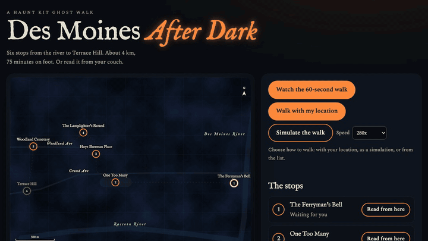
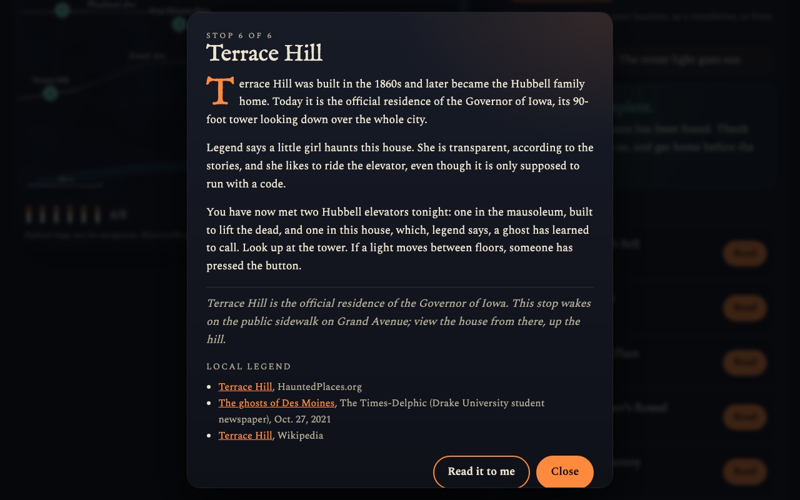
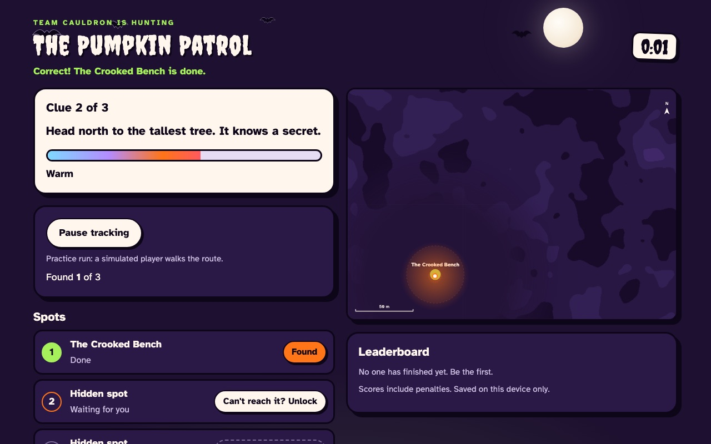
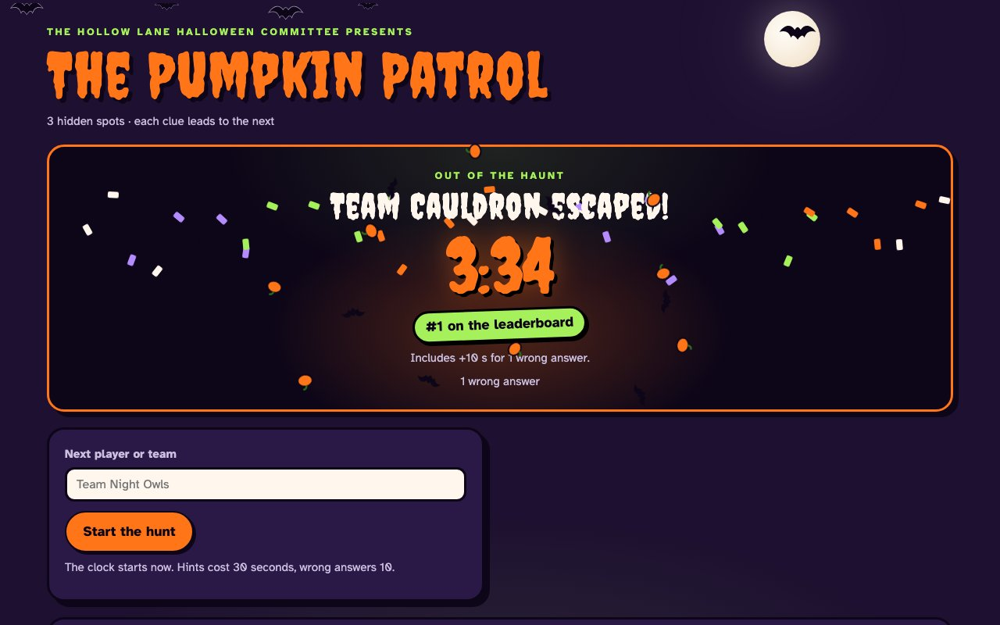
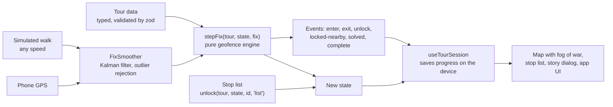

# Haunt Kit

[](https://github.com/blackwingArtisan/haunt-kit/actions/workflows/ci.yml) [](LICENSE)

**A haunted tour that fits in a QR code: no server, no keys, the ghost lives in the link.**

Most GPS hunts need a server and an account. Haunt Kit's hunt, answers and scoreboard all travel in links.

Made first for the teacher's Friday hunt: no student accounts, no student data, nothing to install. A Goosechase classroom plan is [$99 per educator per year](https://www.goosechase.com/edu/pricing/) and a single event is [$99 to $749](https://support.goosechase.com/en/articles/14222884-everything-you-need-to-know-about-our-single-event-pricing); Haunt Kit is $0.

Kiroween 2026, Skeleton Crew. One open-source skeleton for GPS story walks, in two costumes: a sourced ghost walk through downtown Des Moines and a Halloween scavenger hunt. Write the stops as data and they unlock as people arrive. Some stops only exist after dark.



## Judge it in 60 seconds
```bash
npm ci
npm run build:site && npm run preview:site   # http://localhost:3169
```
The landing page shows both apps side by side, each with a QR code. Then:

1. **Watch the 60-second walk.** The whole Ghost Walk route plays at 60x. Each story opens as the lantern arrives, the fog burns off, and the Terrace Hill finale plays. Direct link: `ghost-walk/?watch`.
2. **Play the demo hunt.** One click opens Spook Hunt's three-spot demo exactly as a player receives it. Press **Practice run** and a simulated player walks to each spot and waits for your answer (the answers are "orange" and "bat"). Direct link: `spook-hunt/#/demo`.
3. **Build your own.** In Spook Hunt, choose **Build a hunt**, drop a pin, write a clue, and press **Make the share link**. That link, or its QR code, is the whole hunt. A two-spot hunt takes 8 steps and 55 typed characters from a blank editor to its share link and QR code; a [Playwright test](e2e/scavenger-hunt.spec.ts) walks it at a human typing pace.

No GPS or walking needed for any of it. Every stop in both apps can also be opened from the list.

| | |
|---|---|
|  |  |
|  |  |

## Why it matters
- **Teachers, first.** A class or field-trip hunt in the schoolyard or a park, every week. Students open a link or scan a QR code: no accounts, no logins, no app, and nothing about them is stored anywhere but their own phones, because there is no server. Goosechase's free classroom plan stops at [5 teams per game](https://www.goosechase.com/edu/pricing/); its Educator Plus plan is [$99 per educator per year](https://www.goosechase.com/edu/pricing/) for up to 40 students per game. The landing page's playable **Friday Word Hunt** shows the kind of hunt this is for.
- **Party hosts.** A backyard or street hunt for one night. Goosechase is free for 3 participants for 24 hours, then [$99 for 10 participants up to $749 for 175](https://support.goosechase.com/en/articles/14222884-everything-you-need-to-know-about-our-single-event-pricing), for one event. Spook Hunt is free, and players can send their times to the host as links.
- **Local history groups.** They have the stories but rarely a budget. There are at least [21,588 history organizations](https://aaslh.org/census/) in the United States, and Halloween is when people go looking for local legends: Americans are expected to spend [$13.5 billion on it in 2026](https://nrf.com/media-center/press-releases/nrf-halloween-survey-shows-consumer-spending-expected-to-reach-13-5-billion). A walk like Des Moines After Dark is a typed data file and a folder of static files.

**Why not a free tour app?** izi.TRAVEL and Google My Maps are free too, but there the tour lives on someone else's platform, and My Maps opens nothing on arrival; with Haunt Kit you own the content in your repository, players install nothing, it works offline, and one QR code on a door is the whole tour. The full comparison, including what Goosechase does that Haunt Kit does not, is in [How it compares](#how-it-compares).

**Time to value.** A two-spot hunt is 8 steps from a blank editor to a share link: a title, two taps on the map, a name and a clue for each spot, and **Make the share link**. That is 55 typed characters in the test that walks it at a human typing pace. The three-spot demo hunt's whole share link is about 520 characters.

> **Scenario (fictional).** A volunteer at the invented Marlow County Historical Society copies the starter on a Tuesday evening and writes six stops about the courthouse square, each legend with its source. She builds the site, puts the folder on a free static host, and tapes one printed poster with its QR code to the courthouse door. Through October, walkers scan it and each story opens as they arrive, with the after-dark stops waking at sunset. The society pays $0.

## One skeleton, two costumes
Both apps run on the same engine, `stepFix(tour, state, fix) → { state, events }`, and the same React pieces. They do different jobs:

| | Des Moines After Dark | Spook Hunt |
|---|---|---|
| Who writes it | A volunteer or developer, as a typed data file (`tour.ts`) | A party host or teacher, in the browser editor, with no code |
| Where the content lives | In the app build | In the share link's URL hash; answers only as salted hashes |
| The loop | Walk to a stop and its sourced story opens; one stop wakes only after sunset | Walk to a hidden spot, answer its question, get the next clue; an EMF meter reads warmer or colder |
| The ending | The Terrace Hill finale, after the other five stops | An escape time with penalties, a leaderboard and a result link for the host |
| Skeleton parts used | `useTourSession`, `TourMap` (ink fog), `StopList`, `Compass`, `StopSources`, `useStopDialog`, `createNarrator` | `useTourSession`, `TourMap` (paper fog, hidden spots), `StopList`, `awaitingAnswer`, `hashAnswer`, `getCurrentFix` |

Measured in this repository (lines, including styles):

| Part | Lines |
|---|---|
| The shared skeleton, `template/src` | 2,600 |
| Ghost Walk app, `apps/ghost-walk/src` | 907, of which the tour data is 214 |
| Spook Hunt app, `apps/scavenger-hunt/src` | 1,990 |
| The starter a new app copies, `template/starter` | 90 |

Start a third costume with one command:

```bash
npm run create-app -- river-walk --name "River Walk"
```

## Built with Kiro
| Kiro feature | In this repo |
|---|---|
| Steering | Product rules written before any code: no server and no keys, every stop reachable without walking, honest stories with sources, respect for real places. [`.kiro/steering/`](.kiro/steering/) |
| Specs | One spec for the skeleton and one per app, with EARS requirements, a design and a task list. Kiro rewrote every criterion in EARS form and audited each task against its tests. [`.kiro/specs/`](.kiro/specs/) |
| Spec task execution | Kiro built two tasks end to end: Spook Hunt's "Send my time to the host" result link and the `create-app` starter generator, each with unit tests. |
| Hooks | Run the unit suite on save, guard the Ghost Walk honesty rules when tour data changes, and keep the core engine pure. [`.kiro/hooks/`](.kiro/hooks/) |
| Agent session | One recorded `kiro-cli` session with its exact prompt, time and credits. Unit tests went from 82 to 104. |

[KIRO-LOG.md](KIRO-LOG.md) has the evidence for each row, the exact session prompt, and a plain note on who wrote what.

## Beyond October
The skeleton is not only for Halloween. Three uses that repeat all year:

- **A teacher's weekly word hunt.** Tape a scrambled vocabulary word at each spot in a park or schoolyard; students unscramble it to get the next clue. The landing page links a playable three-spot "Friday Word Hunt", made with the same share function the editor uses.
- **A library's monthly story walk.** A picture book split into pages along a path, one page per stop, as a data tour copied from the starter.
- **Campus orientation week.** First-year students find the library, the bursar and the dining hall, with a question at each to prove they were there.

Any of them can go on a wall: the landing page's **Print a poster** page prints one page per app with its QR code, its start point and tonight's sunset time, and a host can paste their own hunt link onto it.

## Where this goes
- **The kit stays free.** MIT license, static files, no keys, no server. Everything in this repository, including both apps and the generator, stays free to copy and self-host.
- **Only what needs a server is paid.** A hosted story-walk builder (the Spook Hunt editor, for story walks, published to a static host), neural narration rendered for each stop, and live leaderboards shared across many phones. Each of these costs money to run, so each is part of an optional hosted plan.
- **Priced under what schools already pay.** Goosechase's Educator Plus plan is [$99 per educator per year](https://www.goosechase.com/edu/pricing/). A hosted plan at $49 a year per school or organization is half of one teacher's seat and covers the whole building.
- **Who it is for.** Teachers first, then at least 21,588 history organizations ([AASLH](https://aaslh.org/census/)) and about 9,000 public libraries with about 17,000 branches and bookmobiles ([IMLS Public Libraries Survey](https://www.imls.gov/research-evaluation/surveys/public-libraries-survey-pls)).
- **Why now.** A web page can do what a tour app once needed an install for: the Geolocation API works in browsers used by 97.6% of people worldwide, and service workers, which make a page work offline, in 97.4% ([caniuse data](https://github.com/Fyrd/caniuse), November 2026).

## For developers
How the engine works, how it compares with other tools, and how to run, test, extend and deploy it.

### How it works


The engine is a set of pure functions (`stepFix` for a position fix, `unlock` for the list, `markSolved` for an answer), so every rule (two-fix dwell, exit at 1.3x the radius, free, in-order, `requires` and finale ordering) is unit-tested without a browser. The React layer only stores and renders. Spook Hunt compresses its whole hunt into the URL hash and stores answers only as salted hashes, so the share link never gives the answers away.

### How it compares
| | Haunt Kit | izi.TRAVEL | Actionbound | Goosechase | Google My Maps |
|---|---|---|---|---|---|
| Players install an app | No: a web page, installable for offline use | Mobile app; tours can also be browsed at izi.travel | Yes: [iOS or Android app](https://actionbound.com/faq) | No: [app or browser](https://goosechase.com/download) | No |
| Content opens on arrival | Yes | Yes | Yes | Yes, as GPS check-in missions | No: a static map |
| Every stop reachable without walking | Always: any stop opens from an accessible list, by design | Yes: tours can be browsed at izi.travel | Only where the author lets a [find-a-spot task be skipped](https://en.actionbound.com/help/article/find-spot) | No: a GPS mission needs a [check-in inside its radius](https://support.goosechase.com/en/articles/5803495-how-to-create-a-gps-mission) | Nothing is locked |
| Player location leaves the phone | Never: every geofence check runs on the device, and there is no server | Hosted platform: see its privacy policy | Hosted platform: see its privacy policy | Hosted platform: see its privacy policy | No location is used |
| Where the tour lives | In the link, or a static file you host | izi.TRAVEL's platform | Actionbound's platform | Goosechase's platform | Google Drive |
| Photo or video missions, live activity feed | No: answers are typed, and results reach the host as links | Not compared | Not compared | Yes: photo and video submissions in a [real-time activity feed](https://www.goosechase.com/edu/pricing/) | No |
| Cost | Free (MIT, static hosting) | Free for visitors, and its publisher CMS is [free for creators](https://izi.travel/en/create/professionals) | [Free for personal use](https://en.actionbound.com/pricing); paid EDU and PRO licenses | [Free for 3 people, then $99 to $749](https://support.goosechase.com/en/articles/4571290-how-much-does-goosechase-cost) per event; classroom plan [$99 per educator per year](https://www.goosechase.com/edu/pricing/) | Free |
| Source code | Open (MIT) | Closed | Closed | Closed | Closed |

Prices and features are from each product's published pages in November 2026. Where Goosechase is ahead: photo and video missions and a live feed the host watches during the game. Haunt Kit trades those for no accounts, no server and no per-player price.

### What works
<details>
<summary>Everything the template and both apps do today</summary>

- **Template (`template/`)**
  - Tour format validated with zod, with readable errors: duplicate ids, unknown or circular `requires`, a missing source on a legend.
  - Geofence engine: haversine distance, a two-fix dwell, an exit at 1.3 × the radius, and free, sequential, `requires` and finale ordering. Overlapping stops unlock in tour order, and a walker already standing in a stop gets it the moment the rules allow.
  - Jitter smoothing: a Kalman filter weighted by GPS accuracy, rejection of vague fixes and impossible jumps, and a reset after repeated outliers.
  - Simulated walk: a time-based track at walking pace, pauses at stops, seeded noise for repeatable replays, and any speed.
  - Progress saved on the device, which survives reloads and falls back to memory when storage is blocked.
  - Stylized SVG map with fog of war that lifts along your trail. No tiles and no keys.
  - Stops that wake at sunset: `wakesAfter: 'sunset'` keeps a stop asleep to GPS until dark, with sunset computed on the device. The list and simulated walks always open it.
  - Accessible list of every stop: you can unlock any stop the rules allow without walking, everything works by keyboard, the story dialog returns focus, and there is a reduced-motion mode.
  - Installable offline PWA: a Vite plugin writes the manifest, the icon and a precaching service worker.
- **Des Moines After Dark**
  - Walk with your GPS, and each story opens as you arrive.
  - Simulate the walk from 1× to 500× speed.
  - Read from home through the list. A speech synthesis "Read it to me" option.
  - The Lamplighter's Round wakes at sunset. A daytime walker is told the exact time to come back, or can read it from the list.
  - Six candles light as you find stops. The Terrace Hill finale waits for the other five, and finding it plays a full-screen finale.
  - "Watch the 60-second walk" plays the whole route at 60x, opening and closing each story as the lantern passes.
- **Spook Hunt**
  - Editor: record your current spot, tap the map, zoom, edit coordinates, reorder stops, choose any order or in order, and the draft autosaves.
  - Share: a compressed link (the three-stop demo link is about 520 characters), a QR code drawn on the device, and copy and play-now buttons.
  - Play:
    - The hiding spots stay hidden until found.
    - An EMF meter reads warmer or colder as a player closes in.
    - Questions take penalties: +10 s per wrong answer, +30 s per hint.
    - A practice run replays the hunt as a simulated walk, waiting at each found spot until its question is answered.
    - "Play the demo hunt" on the home screen opens the three-spot demo as a player in one click.
    - Anyone who can't reach a spot can unlock it from the list, and these unlocks are marked on the result.
  - The leaderboard on the device ranks runs by time plus penalties.
  - A player on their own phone can tap "Send my time to the host". The result link holds only the name, time, penalties and the hunt's short id (no answers, no hiding spots, no server). The host opens it and taps "Add to leaderboard"; a result for a different hunt, a damaged link or a repeat is refused with a message.

</details>

### How to run
Requires Node 24 or newer.

```bash
npm install
npm run dev:ghost    # Des Moines After Dark on http://localhost:3170
npm run dev:hunt     # Spook Hunt on http://localhost:3172
```

No walking needed: press **Simulate the walk** (or **Practice run** in a hunt). Add `?speed=200` to the Ghost Walk URL for a 200× replay.

Start your own walk with the generator. It copies `template/starter` into a new `apps/<folder>` and prints the workspaces line to add (it does not edit the root `package.json`):

```bash
npm run create-app -- river-walk --name "River Walk"
```

See [`template/README.md`](template/README.md) for the options.

The hosted layout (landing page at the root, the apps in `ghost-walk/` and `spook-hunt/`), built into `dist/`:

```bash
npm run build:site
npm run preview:site                    # http://localhost:3169
```

Each app on its own, as the end-to-end tests run it:

```bash
npm run build
npm run preview -w apps/ghost-walk      # http://localhost:3171
npm run preview -w apps/scavenger-hunt  # http://localhost:3173
```

### How to test
```bash
npm run check                         # TypeScript (strict) + Vitest unit tests
npx playwright install chromium       # once
npm run test:e2e                      # builds both apps and runs Playwright against the preview servers
npm run verify                        # all of the above
```

The same `npm run verify` runs in GitHub Actions on every push to `main` and every pull request ([`.github/workflows/ci.yml`](.github/workflows/ci.yml)).

<details>
<summary>What the unit and end-to-end tests cover</summary>

- **Unit tests (Vitest)** cover:
  - Geo math and smoothing.
  - Tour validation.
  - The geofence engine: dwell, hysteresis, each ordering rule, overlap, settle-in-place, completion, immutability.
  - Solar math against published Des Moines sunset times, and sunset-wake stops.
  - Simulation determinism.
  - Adapters, using fake geolocation and a manual clock.
  - Progress persistence and the projection.
  - The generated service worker, run in a sandbox: precache, the offline shell, cache-first assets, and cleanup of old caches.
  - The hunt-link codec: round-trip, compression fallback, answer secrecy, size budget, damaged links.
  - The result-link codec and host leaderboard: round-trip, damaged link, wrong hunt, duplicate, no answers or coordinates, size.
  - The app generator: file map, name checks, refusal to overwrite, and a generated tour that passes the schema.
  - The leaderboard, the EMF meter (hot and cold), and the Ghost Walk data rules (sources, labels, a completable route).
- **End-to-end tests (Playwright, Chromium)**: each app is driven through a simulated GPS walk and checked as its stops unlock.
  - Both apps:
    - Real browser geolocation through Playwright's location override: a story opening on arrival, and a hunt's EMF meter.
  - Ghost Walk:
    - Keyboard-only reading.
    - Fiction labels.
    - An offline reload through the service worker.
    - Reduced motion: no animation runs, candles stop flickering.
    - A phone-width layout.
  - Both apps also pass an axe-core audit for WCAG 2.1 A and AA on every main screen, checked after real use (a finished walk, an open story, a shared hunt, a hunt in play).
  - Spook Hunt:
    - A host builds a hunt from a recorded GPS spot and a map pin.
    - Time to value: a two-spot hunt from a blank editor to its share link in 8 steps, typed at a human pace.
    - The host shares the link, and a player races it with a wrong answer and then the right one.
    - The leaderboard records the run.
    - A player on another phone sends a result link and the host adds it to the leaderboard.
    - A list unlock with a hint, and a damaged link.
- **Hosted layout (Playwright)**: the landing page passes axe-core with both QR codes, both apps run from their subfolders, one click starts each demo, the word hunt link opens a playable hunt, and the poster page prints two pages.

</details>

### Architecture
```
template/                         @haunt-kit/template
  src/core/       pure TypeScript: geo, smoothing, tour schema, session, rules,
                  geofence engine (stepFix), simulation, answers, projection
  src/adapters/   PositionSource, Narrator, KeyValueStore + env-based selection
  src/react/      useTourSession, TourMap, StopList, Compass, StopSources, useStopDialog
  src/pwa/        Vite plugin (manifest, icon, service worker) + registration
  starter/        three-stop tour and a ~50-line app to copy
  scripts/        create-app generator (npm run create-app)
apps/ghost-walk/        Des Moines After Dark (tour data + themed UI)
apps/scavenger-hunt/    Spook Hunt (editor, link codec, player, leaderboard)
site/                   landing page that hosts both apps, and printable posters (npm run build:site)
docs/media/             README images
e2e/                    Playwright specs
.kiro/                  steering, specs, hooks
```

Builder docs for the template are in [`template/README.md`](template/README.md).

### Adapters (local vs real)
<details>
<summary>Every outside service sits behind an interface with a free local default</summary>

The free local implementation is the default and the one used in tests. Environment variables select the implementation:

| Adapter | Local (default, free) | Real | Selected by |
|---|---|---|---|
| Position | `SimulatedWalkSource` | `BrowserGeolocationSource` (the device's own GPS, free) | the walker's button choice |
| Narration | `SpeechSynthesisNarrator` (the browser's voices); `SilentNarrator` in e2e | `PollyNarrator`: Amazon Polly neural voices, paid, through a Cognito identity pool | `VITE_HAUNT_NARRATOR=browser \| silent \| polly` |
| Storage | `LocalStorageStore`; `MemoryStore` as fallback and in tests | the same interface fits a synced store later | `VITE_HAUNT_STORAGE=local \| memory` |
| Map | stylized SVG drawn from tour data | none needed: no tiles or keys | none |
| Sharing | hunt encoded in the URL hash, QR drawn locally | none needed: no server | none |

The Polly adapter is written and type-checked, but it has not been run against AWS. The SDK is loaded only in a build made with `VITE_HAUNT_NARRATOR=polly`, through a build-time constant, so the default bundles contain no AWS code. To use it, set:

- `VITE_AWS_REGION`
- `VITE_POLLY_IDENTITY_POOL_ID` (an unauthenticated Cognito role limited to `polly:SynthesizeSpeech`)
- optionally `VITE_POLLY_VOICE`

</details>

### Deploy (free, static)
`npm run build:site` writes one static folder, `dist/`, with relative paths throughout, so it can be served from any static host or a subfolder of one: Cloudflare Pages, GitHub Pages, Netlify, or Amazon S3 behind CloudFront. Geolocation and the service worker need HTTPS, which all of these provide.

```bash
npm run build:site
npx wrangler pages deploy dist --project-name haunt-kit   # for example
```

## Sources for the Ghost Walk
Every legend and history stop links its sources in the app. The sources are:

- The Times-Delphic, "The ghosts of Des Moines" (2021)
- HauntedPlaces.org, "Terrace Hill"
- Iowa PBS, "Iowa's Unique Gravestones and Burials"
- the Wikipedia articles on Hoyt Sherman Place, Woodland Cemetery and Terrace Hill

The stories are paraphrased in our own words. Wikipedia text is available under [CC BY-SA 4.0](https://creativecommons.org/licenses/by-sa/4.0/), and the facts drawn from it are credited to the Wikipedia contributors of the linked articles. Stop coordinates were checked against Wikipedia and OpenStreetMap (© OpenStreetMap contributors, ODbL).

Terrace Hill is the residence of the Governor of Iowa, so its stop wakes on the public sidewalk on Grand Avenue, about 130 m north of the house, and walkers are asked to stay there.

## Third-party notices
Dependency, font and content credits are listed in [THIRD-PARTY-NOTICES.md](THIRD-PARTY-NOTICES.md).

## License
MIT © 2026 Stubborn Otter Software
